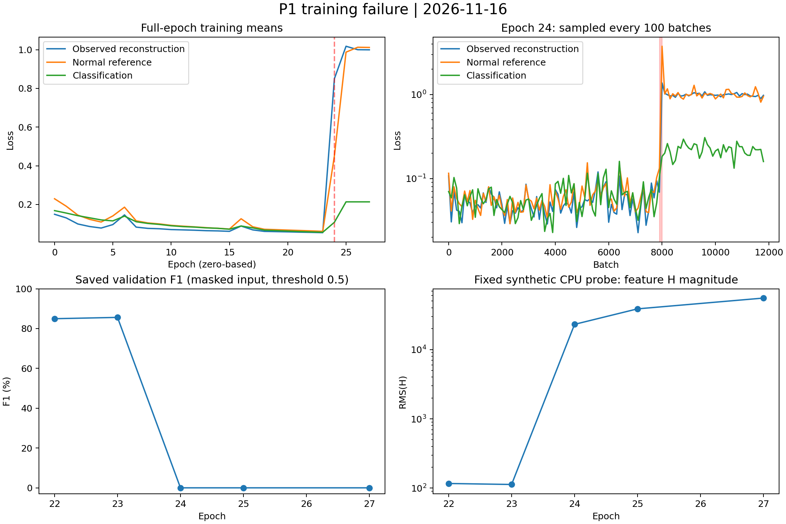

# P1训练异常分析（2026-11-16）

> 当前资产状态（2026-11-16）：用户已确认删除两份P0诊断run和首份P1 epoch24重放run；下文是历史事实，原run内日志/诊断/权重已不可用，汇总见上级run_cleanup_execution_20261116.json。新P1原训练保留best、epoch23/24/27，仍可作为恢复/前后对比来源。

> 维护注（2026-11-16）：本页保留当时事实；部分临时清单/测试日志已清理，长控制台记录改为 `.log.gz`，映射见上级 `CLEANUP_20261116.md` 与 `cleanup_20261116.json`。

受众：Agent及本次分析复核。run：p1_mask_normal_official_dp_20261115_015137。epoch/batch均从0开始；时间为北京时间。检查范围为完整训练日志、已保存验证统计、epoch22/23/24/25/27模型与AdamW状态、固定CPU合成前后向探针。未重启/停止训练、未执行优化器更新、未做完整检测评测。

## 结论与当前状态

发生了严重的学习退化：epoch24约batch7900–8000之间出现明显转折，此后双重构接近零预测基线，分类在完整训练验证集上全部预测正常，持续到epoch27轮末与epoch28采样日志。15:15快照进程仍在运行，epoch28 batch900总loss2.1791。不是仅有一次日志尖峰。

现有证据确认了梯度异常历史和退化后的机制；尚未捕获第一次触发的实际batch，因此不能宣称已确定最初根因。建议停止当前退化训练、保留资产，之后从epoch23轮末在新run做诊断重放；这些运行操作本次尚未执行。

## 1. 时间与损失

| epoch | Train总均值 | 观测重构 | 正常参考 | 分类CE | valid_total |
|---|---:|---:|---:|---:|---:|
|22|0.177501|0.0558|0.0635|0.0582|0.170937|
|23|0.171484|0.0543|0.0610|0.0562|0.172989|
|24|1.408600|0.8502|0.4505|0.1079|2.178334|
|25|2.219121|1.0180|0.9875|0.2136|2.227648|
|26|2.226622|1.0002|1.0128|0.2136|2.228031|
|27|2.224984|0.9996|1.0118|0.2136|2.227714|

以上train均值累计整轮11875批，分项日志保留4位。采样batch每100步记录一次，不能替代全批极值。

| epoch24 batch | 时间 | 总loss | 观测重构 | 正常参考 | 分类 |
|---|---|---:|---:|---:|---:|
|7800|10:39:59|0.2490|0.0941|0.1034|0.0514|
|7900|10:40:19|0.3052|0.0688|0.1321|0.1043|
|8000|10:40:39|5.3098|1.3725|3.7540|0.1834|
|8100|10:41:33|2.2494|1.0341|1.0148|0.2005|
|8200|10:42:12|2.4259|0.9949|1.1701|0.2609|

7900–8000定位的是采样日志显示的转折窗口，不证明首个异常更新一定在该范围，更不能把8000当作首次异常或全程峰值。epoch5与16曾有可恢复波动；本次已经连续多轮退化。读取日志未见NaN/Inf、OOM、Traceback。

## 2. 分类也已失效

下表直接取已有checkpoint.validation，未重新评测。它是训练阶段的遮挡输入、有效点、argmax（等价0.5阈值）指标，不是RESULTS.md中官方检测协议的F1。

| epoch | precision | recall | F1 | accuracy | TP | FP | FN |
|---|---:|---:|---:|---:|---:|---:|---:|
|22|0.938404|0.776070|0.849552|0.984913|3360267|220565|969583|
|23|0.920991|0.799748|0.856098|0.985243|3462791|297062|867059|
|24|0|0|0|0.945114|0|0|4329850|
|25|0|0|0|0.945114|0|0|4329850|
|27|0|0|0|0.945114|0|0|4329850|

验证有效点78888177，正常74558327、异常4329850，异常比例5.4886%。accuracy94.51%正是全预测正常的结果，不是模型仍有效。分类CE约0.213与只预测异常先验概率的常数分类器相符；CE不必很大才意味着失效。所有验证轮的点数和配对复制基线一致。

## 3. 特征放大、GELU饱和与梯度中断

固定CPU eval探针：4条512点单变量，sin(t/11)、sin(t/23)+0.3cos(t/5)、cos(t/17)、sin(t/8)，第三条[160:224]加3，合并标准化。统一遮挡[64:96]、[176:192]、[320:352]；另做完整输入前向。探针不取训练数据，不作为检测成绩，不代表所有真实输入。

| checkpoint epoch | 遮挡探针 RMS(H) | max abs(H) | 异常概率表现 |
|---|---:|---:|---|
|22|116.75|3350.68|随位置变化|
|23|112.99|3148.27|随位置变化|
|24|23102.93|169514.22|全部约0.056203|
|25|38647.09|291255.63|全部约0.054371|
|27|55311.27|388952.50|全部约0.055835|

epoch23→24的H RMS增加约204倍，epoch27约为23的490倍。epoch24 Transformer第3层（索引2）输出RMS为4207.54，epoch23同层174.01；最终编码器输出由136.91升至4805.68，投影后H达到23102.93。说明异常后的放大同时存在于骨干与投影输出，不仅是末端标量输出问题；不能据轮末位置推断最先出问题的层。

epoch24分类头第一层线性输出最大值仍为-12608，全部位于GELU极负区域；其GELU输出在FP32下全为0，最终logits严格等于输出层bias。正常参考头第二个GELU也全为0。epoch25观测头第二个GELU全为0。epoch27两个重构头可出现由bias/固定patch位置形成的小变化，但已无法通过H传递有用梯度。

在同一遮挡探针上，将H分离后设requires_grad，分别计算每个头的dL/dH：

| epoch | 观测重构梯度范数 | 正常参考梯度范数 | 分类梯度范数 |
|---|---:|---:|---:|
|23|1.8827e-5|5.9368e-5|2.3968e-5|
|24|3.4514e-6|0|0|
|27|0|0|0|

正常参考头在此导数连通性测试中以X作为人为目标，只检验是否能向H传梯度；该loss不能当作真实X0预测误差。分类目标仅第三条[160:224]为异常。没有optimizer.step。此结果只证明所测输入的梯度路径；实际训练末期骨干Adam一阶矩接近零提供独立佐证，不能断言所有可能输入都永久无法恢复。

GELU(u)=uΦ(u)，极负区导数也趋于0。三头退化后，偏置仍可学习：重构输出接近0、分类输出接近异常先验。X标准化后的平方均值约1，因此零预测MSE约1；正常参考在当前数据中同量级，总loss约1+1+0.213=2.2。这解释了“爆发之后看起来不再很大”的平台，并不表示恢复。

## 4. Adam状态证明存在未被稀疏日志充分描述的异常梯度

所有受检参数与Adam一/二阶矩均有限。参数总范数没有出现所有权重同时达到巨大值的现象；特征放大不能简化成每个权重都爆炸。

所有参数exp_avg_sq求和：
- epoch23：4.68414；
- epoch24：301824269.106；
- epoch25：67853.041；
- epoch27：0.042005。

epoch24中骨干约2.459e8、embedding约5.443e7、观测头约1.332e6、正常头约1.309e5。Adam步数依次为285000与296875，相差11875；beta2=0.999。二阶矩满足V_t=beta2 V_(t-1)+(1-beta2)||g_t||²。由轮初/轮末状态可得本轮某次全参数梯度范数至少约1.74e4（忽略浮点舍入），即使每100步的loss打印只看到最高5.3098，也不能认定中间没有严重梯度事件。

这不是从checkpoint还原出的峰值或事件batch；大梯度也不必对应同比例的大loss。二阶矩先抬高可压低后续有效更新，但到epoch27它已明显衰减，梯度连通性仍为零，因此不能只靠“等Adam恢复”解释或解决平台。

## 5. 代码事实与原因排序

- data.py:79–83：仅将X按batch标准化；X0复用X的统计坐标。H和预测输出不受该约束。X在选中集合上的均方有N/K型上界；X0并未按自身方差标准化，不能直接套用同一上界。首个事故batch的X0是否异常仍待核查。
- ts_encoder_bi_bias.py:178：GELU(gate(x))*up(x)门控MLP；204：残差相加；298/370：最后直接线性投影，无最终归一化。pre-RMSNorm限制子层输入，不保证残差流、门控乘积或最终H幅值有界。
- models.py:26/46：重构MLP为Linear→GELU→Dropout→Linear→GELU→Dropout→Linear，最终输出无界；分类头也有GELU，能一起进入极负饱和。
- train.py:137、235–241：固定lr5e-4的AdamW，反向后直接step，没有梯度裁剪或lr衰减。普通训练默认无逐batch有限值诊断。
- 三项loss权重1不意味着进入共享骨干的梯度同尺度。双重构梯度可能增加优化风险或冲突，但本次未测首个事故的分项梯度，不能归罪新增正常头。
- 训练padding比例各轮约0.45%，重构明确排除padding，未见epoch24配置/采样器切换；padding可能影响学习但没有本次直接触发证据。
- 本次没有AMP。CPU eval模式不启用激活checkpoint、Dropout或DataParallel仍重现坏权重的退化，因此它不是必须开启这些机制才出现的显示问题；这不能排除它们对历史训练轨迹的影响。
- 先前删除的Classification points仅改字符串拼接，当前进程仍用旧版打印，不能解释数值变化。

已确认链条：历史发生极大梯度事件；异常后H幅值大增，多个头GELU饱和，固定输入梯度路径中断，完整验证分类全正常。最初是数据/目标、随机mask、Dropout、重构某分支还是优化器更新触发，尚未确定先后因果。

## 6. 下一步建议（未执行）

1. 停止继续消耗当前退化run；保留best、epoch23、epoch24及后续状态。best.pth实测为epoch22，valid_total0.170937；没有被坏权重覆盖。本次未删除任何权重。
2. 以epoch23为事故重放起点，在新run通过统一入口resume；保持模型/AdamW/RNG/batch/采样/mask/双卡不变。它比旧P0检查点多了完整RNG，仍需核对重放早期轨迹，不能预先承诺数值逐位一致。
3. 启用现有diagnostics逐batch记录三项loss、H/两项输出/总梯度、样本ID与mask。它已支持P1两个重构项及首次pre-step现场；进一步增加正常目标统计、分模块梯度、GELU饱和率和事故附近更密集现场。每步分任务额外反向只在离线事故重放中做，避免将其伪装成无侵入日志。
4. 定位首个异常batch后，分别比较目标能量、前向输出、分项梯度和更新前后状态；再从同一现场对照梯度裁剪或降低学习率，一次只改一项。若验证最终特征尺度是关键，再设计H归一化的P0/P1共同对照。不要同时改归一化、损失和采样后宣称解决根因，也不要以输出标准化掩盖问题。
5. 当前best仍可供后续共同官方检测评测；训练后期失败不自动作废已保存best，也不代表P1已优于P0。

## 证据

- log_analysis.json：15:12完整日志解析，整轮统计、全部采样batch、进程及显存快照。
- checkpoint_analysis.json：五个检查点的原始验证、各参数/Adam统计、固定探针输出和层激活。
- gradient_probes.json：三检查点逐头dL/dH和骨干各层输出幅值。
- failure_overview.png：训练曲线、转折窗口、已有验证F1、固定探针H幅值。
- 原始run的train.log与checkpoints为权威资产；本报告不是新的训练/评测结果。

